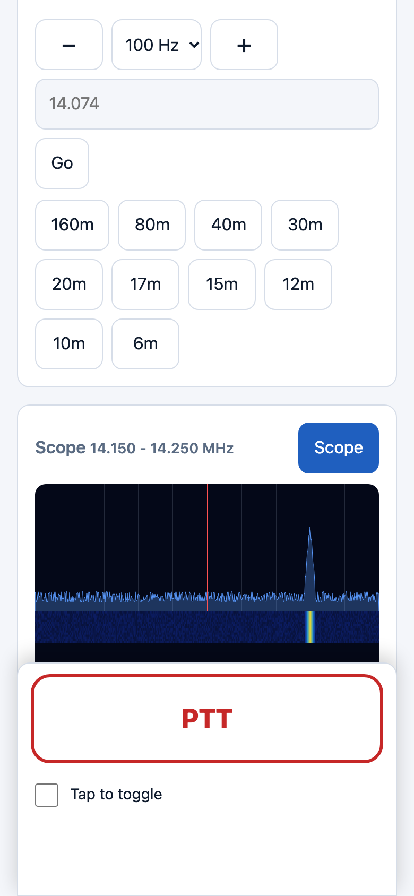
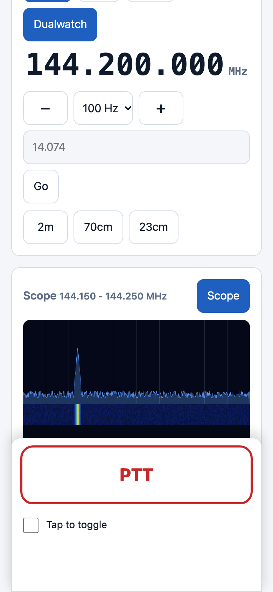

# radio-web-remote

Self-hosted browser remote control for amateur radio transceivers over USB.
A small server runs on the computer cabled to the radio; any browser on the
LAN or a VPN gets the controls, spectrum scope, receive audio and transmit.
No app to install on the phone, tablet or laptop.

<p>
  
  
</p>

Status: **0.1.1.** Built for a club's members, tested on real
radios ([docs/hardware-test.md](docs/hardware-test.md)).

## Supported radios

| Radio | Over USB | Checked on hardware |
|-------|----------|---------------------|
| Icom IC-7300 | control, scope, audio, PTT | yes |
| Icom IC-705 | control, scope, audio, PTT | yes (firmware 1.32) |
| Icom IC-9700 | control, MAIN/SUB, satellite indicator, scope, audio, PTT | yes (firmware 1.50) |

The core is vendor-neutral; other makers can be added
([CONTRIBUTING.md](CONTRIBUTING.md)).

## What it does

- Frequency (type it, step it, drag it, or tap the scope), mode, filter,
  DATA mode, AF and RF gain, squelch, RF power, and S, Po, SWR and ALC meters.
- Spectrum scope and waterfall in every scope mode the radio documents.
- Several radios on one computer: a menu at the top of the page switches
  between them, and the page opens on the radio used last. On macOS and
  Linux each radio finds its own audio by USB hub, with no device numbers.
- Audio both ways in the browser, or on the radio computer's own mic and
  speaker. Works on iPhone and iPad in Safari and as a home-screen app.
- **Transmit safety enforced on the server:** unkey on release, closed
  connection, missed heartbeats (2 s), hidden page, and a TX timeout of at
  most 3 minutes; one transmitter at a time; per-user band and power limits
  checked against the frequency the radio says it will transmit on. See
  [docs/regulatory.md](docs/regulatory.md).
- HTTPS with a local certificate authority, accounts with roles (admin,
  operator, listener) and an audit log ([docs/security.md](docs/security.md)).

## Quick start

1. Set up the radio's menus: [docs/radio-setup.md](docs/radio-setup.md).
2. Install on the computer cabled to the radio:
   [Linux and Raspberry Pi](docs/install-linux.md),
   [macOS](docs/install-macos.md), [Windows](docs/install-windows.md).
   On Linux and macOS it is one line:

   ```bash
   curl -fsSL https://raw.githubusercontent.com/kidvelvet/radio-web-remote/main/packaging/install.sh | sh
   ```

3. First run, then let `doctor` find the radio and say what to fix:

   ```bash
   radio-web-remote init
   ```

   ```bash
   radio-web-remote doctor
   ```

4. Add members:

   ```bash
   radio-web-remote user add alice --role operator --callsign N0CALL
   ```

5. Start it (or install it as a service with `--service`):

   ```bash
   radio-web-remote serve
   ```

6. On each phone, tablet or laptop, open `https://<radio computer>:8473/setup`
   once to install the certificate ([docs/ios.md](docs/ios.md) for iPhone and
   iPad), then sign in at `https://<radio computer>:8473/`.

Away from home: [docs/vpn.md](docs/vpn.md). Problems:
[docs/troubleshooting.md](docs/troubleshooting.md).

## Try it without a radio

```bash
radio-web-remote serve --simulate
```

The simulator speaks CI-V like the real radios, scope included.

## Before you transmit

Every operator must hold a license with privileges for the band and mode in
use, is the control operator while transmitting, and must follow the rules
of the country the radio is in. [docs/regulatory.md](docs/regulatory.md).

## Developing

No admin rights needed: `./scripts/bootstrap.sh` (or `scripts\bootstrap.ps1`)
puts `uv` in `.tools/` and the environment in `.venv/`. Then
`.tools/bin/uv run pytest`. Design: [docs/adr/](docs/adr/); plan and status:
[docs/plan.md](docs/plan.md); radio commands and their sources:
[docs/civ-reference.md](docs/civ-reference.md). See
[CONTRIBUTING.md](CONTRIBUTING.md).

## License

MIT. See [LICENSE](LICENSE) and [THIRD_PARTY_NOTICES.md](THIRD_PARTY_NOTICES.md).
Report security problems privately: [SECURITY.md](SECURITY.md).
